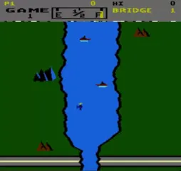
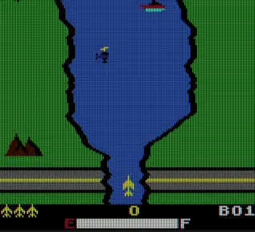
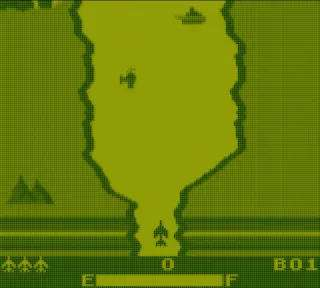

# River Raid — Nintendo 8-bit ports

The purpose of this project is to port **River Raid** (1983, Activision) from the **Atari XL/XE 8-bit computers** to Nintendo's 8-bit platforms — **NES, Game Boy (DMG) and Game Boy Color (GBC)** — as faithfully as possible.

The game logic and the procedural river come from a reverse-engineered Atari binary (disassembly, live captures in an Atari emulator); no Atari source code is used. All ports are written in C with GBDK-2020 (SDCC), with hand-written assembly where it pays. NES and Game Boy share one source tree.

Project was created with heavy AI assistance. Mainly by DeepSeek V4.1 Flash and Sonnet 5.5 with Opus 5.5 as an advisor.

---

## NES

- **Biggest challenge:** the original draws the river with the Atari's per-scanline playfield; the NES has only 2 KB of RAM (a few bytes were left free) and a fixed pattern-table budget, so every river row is rebuilt as exact 8x8 tiles in a CHR cache.
- Atari behaviour (enemies, fuel, bridges, scoring, sound) was recovered by reverse engineering and verified against live Atari captures, not guessed.
- Game logic runs at 30 Hz while the river scrolls at 60 Hz, with the HUD on a split scroll.
- Performance was the long fight: a hand-written assembly river renderer cut late (dropped) frames in fast flight from 16–25% to 1–3%.
- Full game feel: attract mode, menus, start-level select, per-level high scores, sound effects and the side tank / helicopter missile shooters.

## Game Boy Color

- **Biggest challenge:** the exact river on a small screen and a Z80-like CPU — the game keeps the Atari/NES coordinates for logic, and only drawing goes through a camera that converts them to the 160x144 display.
- Same exact-tile approach as the NES: a cache of exact river blocks, no fixed edge atlas, with the tile data uploaded just in time.
- Sound is a direct map of the NES sound onto the Game Boy's pulse and noise channels.
- The banked ROM (MBC5) holds entities, player and sound in separate banks, and the CPU runs in double-speed mode for headroom.
- Colour palettes reproduce the Atari look: land flip after a bridge, red low-fuel gauge, bridge-flash water.

## Game Boy (DMG)

- **Biggest challenge:** the same exact river with no colour, **one VRAM bank (384 tiles) and a single-speed CPU** — the GBC budget of ~260 river tiles plus sprites and HUD simply did not fit.
- Solved by uploading each row 32 px above the view (delay queue), sharing identical sprite tiles across groups and trimming the HUD to 26 tiles; the exact river now needs 206 tiles.
- Hand-written sm83 assembly for the hot VRAM copy, checked byte-for-byte against the C reference.
- DMG hardware quirks had to be handled, such as sprite priority by X position rather than OAM order (for example the bridge tile beside the tank).
- The final ROM is a **dual ROM**: one file runs as the colour game on a GBC and as the grey single-speed game on a DMG.
